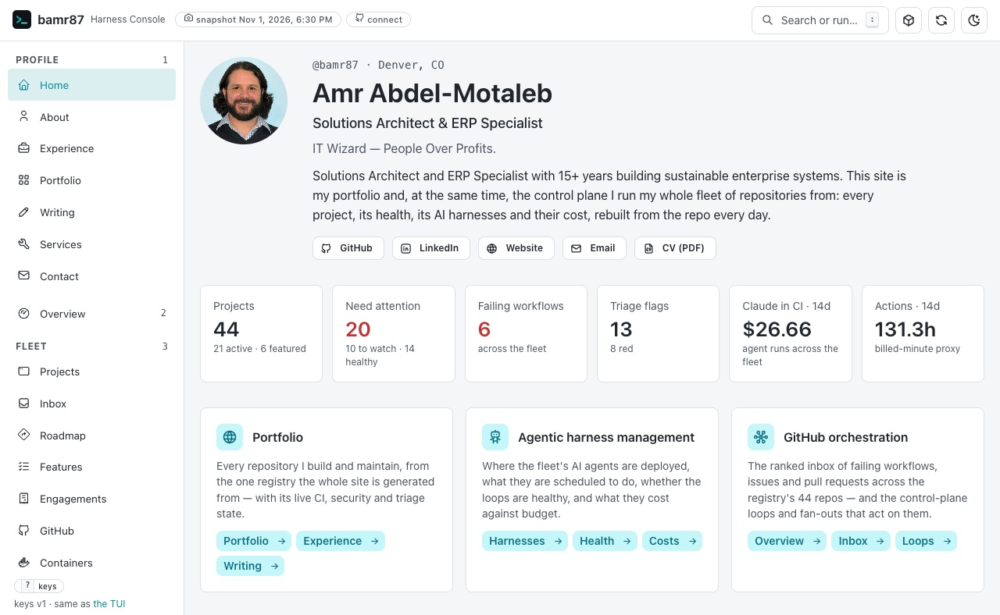
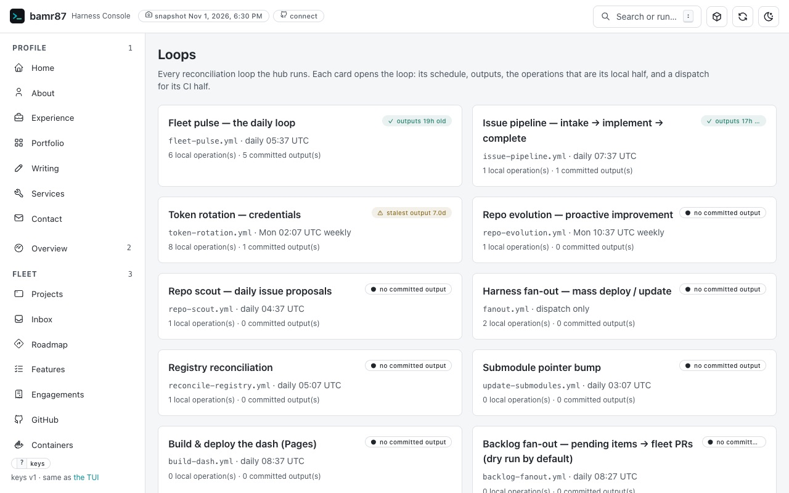
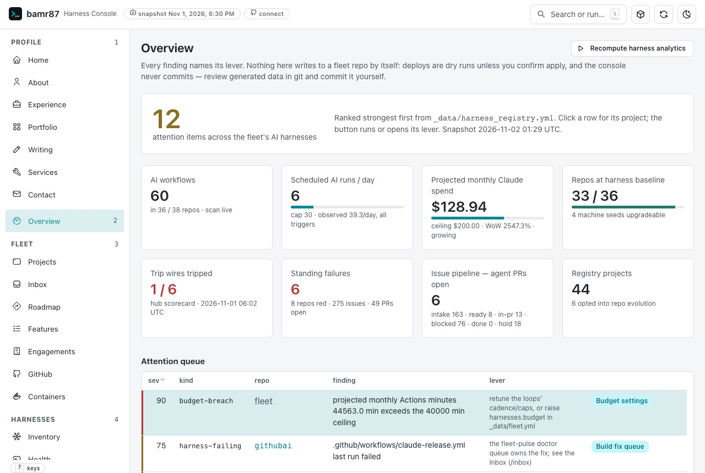
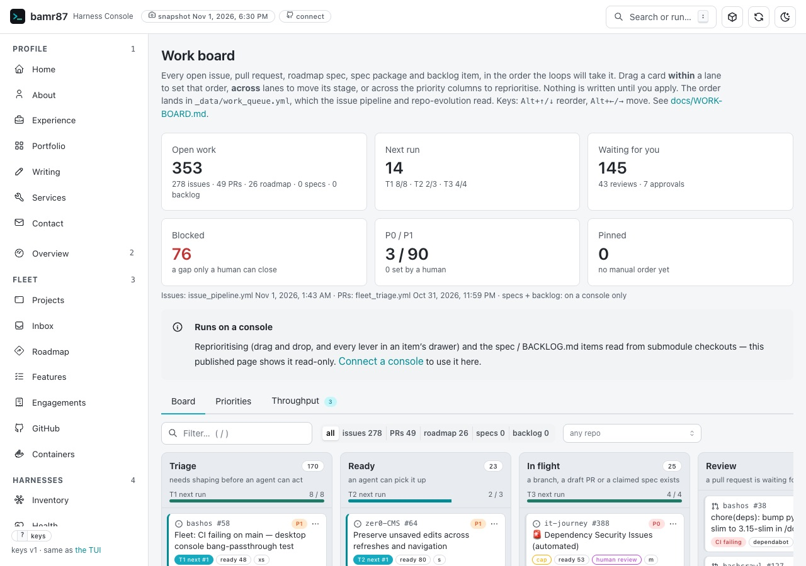
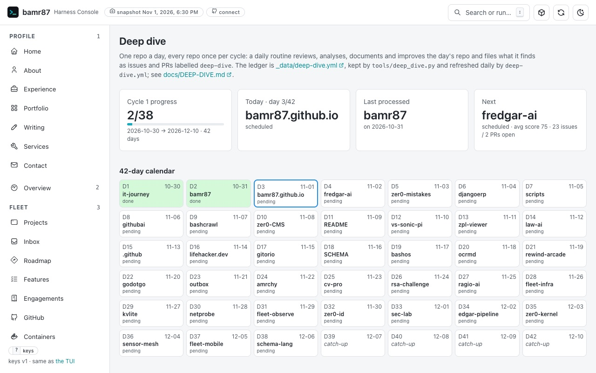

**Level 1111: the control plane.** I skipped a few levels. This is the thing they wouldn't let me build.

An enterprise staffs a portfolio office, a configuration database, a steering committee and a weekly status deck to learn which of its projects are red. The deck is always green.

Mine is one repository, and its front page leads with its own red.

## What it is, and who it is for

[bamr87/bamr87](https://github.com/bamr87/bamr87) is three things in one repository. It is my GitHub profile README. It is the control plane that mounts most of my projects as Git submodules and manages, monitors and standardizes them. And it is the [Harness Console](https://bamr87.github.io/bamr87/), the public site, rebuilt from the repository every day.

The fleet is one YAML file, the registry. As of 1 November 2026 it lists 44 projects: 21 active, 15 experiments, 6 in maintenance and 2 archived. Thirty-eight are mounted as submodules, and 15 have a live site. The hub is not on the list. It is the thing holding the list.

It is for anyone who runs more than one product and has been told that seeing them all in one place takes a tool purchase, a vendor demo and a quarter.

## How it works

**The registry decides.** A generator writes the README's project list from the registry and rewrites it after every merge to main. A drift gate fails any pull request in which the registry and the submodules disagree on a path, a branch or a URL.

**Loops do the work.** The hub runs 33 GitHub Actions workflows, 14 of them on a schedule (counted 1 November 2026). The daily fleet pulse ranks the failing and expensive workflows, and a doctor agent opens fix pull requests. The issue pipeline walks labeled issues from intake to implementation to completion, and it never merges.

**Guardrails ship with the loops.** Every scheduled agent loop has a kill switch, and every headless Claude call has a dollar cap. Fan-outs that push a standard into the fleet are dry runs by default and only ever open pull requests. AI spend is labeled an API-equivalent estimate, because the fleet runs first on a flat $200-a-month subscription and the figure is a priced guess, not an invoice.

**Rules sit above the code.** A 19-section constitution outranks the agent guide, the requirements, the feature catalog, the decision records and the code, in that order. It changes only through a numbered amendment that I ratify by merging, and there are 17 so far. Agents may open pull requests and propose amendments. They may not push to main, force-push, change a setting or print a secret, and a pull request that touches the constitution, a budget, a secret or a setting waits for me.

**The console shows it.** The Harness Console is a React and TypeScript app (Vite, Mantine, TanStack Query) over a FastAPI service. On my machine it can act. The public site is the same app reading a daily snapshot of the same API documents, and a test checks that the snapshot never carries credentials, the local data lake or draft posts. AI agents reach the console through a Model Context Protocol (MCP) server whose actions pass the same confirmation gate.

## The tour

On the evening snapshot of 1 November, the home page showed 20 projects needing attention and 6 failing workflows, in red, under my name.

*Portfolio and control plane on one page, leading with its own red (snapshot of 1 November 2026, 6:30 PM; the Claude figure is an API-equivalent estimate, not a bill).*

Who does the work, and when, fits on one page. The weekly credential rotation shows amber at seven days, right on schedule, because the freshness rule does not know the loop is weekly. A cautious amber beats a confident green.

*The org chart of a one-person enterprise is a list of cron lines (snapshot of 1 November 2026).*

The Overview opens with a sentence I would frame for any governance office: "Every finding names its lever. Nothing here writes to a fleet repo by itself." On 1 November its top item was GitHub Actions: 44,563 minutes on my account's billing meter in October, against a 40,000-minute monthly ceiling. (Early in a month, the row's projection is last month's total.) A crossed ceiling is an attention item, not an enforcement action. Someone still has to pull the lever.

*The over-ceiling Actions minutes, with the lever named; the Claude spend is an API-equivalent estimate, not a bill (snapshot of 1 November 2026).*

The work board counted 353 open items that evening. "Waiting for you" read 145. "Blocked" read 76, with the note "a gap only a human can close". The work is filed. The bottleneck is management, and management is me.

*Everything is filed, and the queue labeled "Waiting for you" belongs to the one human (snapshot of 1 November 2026).*

## What the deep dive found

The deep dive is a daily AI review routine run from this hub. At 06:00 Denver time it takes one of my repositories, every non-archived one once per 42-day cycle, reviews it, files what it finds as issues and pull requests labeled deep-dive, and records the run in a ledger with a public [dashboard](https://bamr87.github.io/bamr87/deep-dive/). It never merges, force-pushes or touches a setting or a secret. I merge its fixes. This series rides on it.

*Day 2 of the routine behind this series was the hub itself: the auditor reviewing the cabinet its own ledger is filed in (as of 1 November 2026).*

Day 2 of cycle 1, on 31 October 2026, pointed it at the hub that keeps its schedule and its ledger. **Score: 78 out of 100.** On day 1, it-journey scored 72.

**What is solid.** I merged all four of its pull requests by 1 November. [#508](https://github.com/bamr87/bamr87/pull/508) fixed the docs-index lint, [#509](https://github.com/bamr87/bamr87/pull/509) and [#520](https://github.com/bamr87/bamr87/pull/520) added five planned features to the catalog, and [#510](https://github.com/bamr87/bamr87/pull/510) recorded the run.

**What is open**, as of 2 November 2026: all 17 of its issues. The best is the finding a governance office never files about itself: the governance lint was passing while the governance records drifted. Seven links in each of the requirements and the feature catalog pointed at amendment drafts that no longer exist ([#500](https://github.com/bamr87/bamr87/issues/500)). Nine merged amendments still read "proposed" when it ran, and section 13 of the constitution sat above section 12 ([#501](https://github.com/bamr87/bamr87/issues/501)). A ratification job recorded the nine on 1 November; section 13 still comes first. So the auditor proposed a lint for the lint ([#505](https://github.com/bamr87/bamr87/issues/505)). Still a proposal; by 2 November the requirements held 10 of those dead links and the catalog 11.

The requirements put the fleet's AI ceiling at $75 a month. The control plane says $200. The auditor did not pick one. It filed the question to the only person allowed to answer it ([#502](https://github.com/bamr87/bamr87/issues/502)).

The rest: a docs-index lint that failed on main while continuous integration stayed green ([#503](https://github.com/bamr87/bamr87/issues/503)); sortable console tables that a keyboard or a screen reader cannot operate ([#504](https://github.com/bamr87/bamr87/issues/504)); two security-hardening items, one waiting on a setting only I can change ([#506](https://github.com/bamr87/bamr87/issues/506), [#507](https://github.com/bamr87/bamr87/issues/507)); five research proposals ([#511](https://github.com/bamr87/bamr87/issues/511) to [#515](https://github.com/bamr87/bamr87/issues/515)); and four planned features ([#516](https://github.com/bamr87/bamr87/issues/516) to [#519](https://github.com/bamr87/bamr87/issues/519)). One proposes maturity levels: the conformance snapshot of 20 October found 0 of 25 checked repositories fully conformant to the hub's own standard, and pass or fail hides progress.

**One more, found while writing this.** The hub is not in its own registry, so the console has no project page for it.

## What is built, and what is still a plan

Built and running: the registry, the generated README list, the drift gate, the loops, the constitution and its amendments, the console in both builds, the MCP server, and the deep dive's ledger and page. So is the repo scout, which files improvement issues across the fleet: it shipped switched off and has run on schedule every day since 30 October. The hub's feature catalog keeps score: 65 features as of 1 November 2026, with 31 shipped, 10 partial and 24 planned. The deep dive itself is still marked partial.

Still a plan: the rest of the map from Badwill Impairment. fleet-observe (OpenTelemetry, Prometheus and Grafana on every service), fleet-infra (infrastructure from git with Terraform, k3s and Helm) and fleet-mobile (the fleet on a phone) each have a repository, and each is marked experimental.

## How to try it

- **Live:** [bamr87.github.io/bamr87](https://bamr87.github.io/bamr87/), the read-only snapshot.
- **Source:** [github.com/bamr87/bamr87](https://github.com/bamr87/bamr87). The hub's own machinery is MIT-licensed.
- **Run it:** `git clone --recurse-submodules https://github.com/bamr87/bamr87.git`, then `./tools/setup.sh`, then `tools/dash console` serves the write-capable console at `http://127.0.0.1:4001`.
- **For agents:** [llms.txt](https://bamr87.github.io/bamr87/llms.txt) and the [machine API](https://bamr87.github.io/bamr87/api/v1/index.json).

*Skill unlocked: running a portfolio the way an enterprise wishes it ran one product.*

This is Level 1111 of [the Quest Log in Badwill Impairment](https://bamr87.github.io/posts/2026/11/01/badwill-impairment/#the-quest-log). The other levels and side quests arrive one deep dive at a time on the [Quest Log series page](https://bamr87.github.io/quest-log/).
